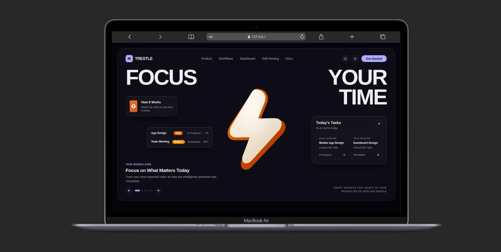

# Trestle Documentation Site

The interactive web documentation project and user manual for [Trestle](https://github.com/blackstart-labs/trestle).

🌐 **Live Website:** [tresstle.vercel.app](https://tresstle.vercel.app)

<p align="center">
  <a href="https://tresstle.vercel.app" target="_blank" rel="noopener noreferrer">
    
  </a>
</p>

## Tech Stack

* **Framework:** [Svelte 5](https://svelte.dev) (Runes) + [TypeScript](https://www.typescriptlang.org/)
* **Build Tool:** [Vite 8](https://vitejs.dev)
* **Styling:** OKLCH Design Tokens, Apple-fluid motion, Mona Sans typeface
* **Features:**
  * Instant client-side search (`Ctrl+K` / `Cmd+K`)
  * Dynamic dark/light mode toggle
  * Code blocks with one-click copy to clipboard
  * Interactive callouts and badges
  * Responsive sidebar and mobile drawer

## Running Locally

To run the documentation app in development mode:

```bash
npm install --prefix docs-site
npm run dev --prefix docs-site
```

The app will be available at `http://127.0.0.1:4000/`.

## Building for Production

To build the static distribution bundle:

```bash
npm run build --prefix docs-site
```

Production static assets will be compiled to `docs-site/dist/`, which can be served by any static web server (such as Caddy, Nginx, Cloudflare Pages, or GitHub Pages).

To preview the production build locally:

```bash
npm run preview --prefix docs-site
```

